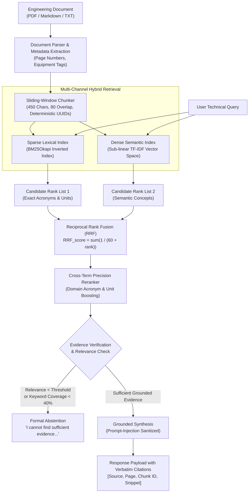

# Engineering Knowledge Assistant with Hybrid Retrieval & Grounded Answers

[](https://github.com/HarshKumarShrimal/engineering-knowledge-rag-assistant/actions/workflows/ci.yml)
[](LICENSE)
[](https://www.python.org/downloads/)
[](https://fastapi.tiangolo.com/)

A local-first, production-oriented Retrieval-Augmented Generation (RAG) platform tailored for engineering technical manuals, standard operating procedures (SOPs), and industrial equipment documentation. Implements **Hybrid Retrieval (BM25 + Dense Vectors + Reciprocal Rank Fusion)**, cross-term reranking, strict evidence-based hallucination abstention, prompt injection sanitization, and reproducible information retrieval evaluation.

---

## Architectural Flowchart



---

## Measured Retrieval Benchmark Results

Evaluated on the synthetic technical manual benchmark (`scripts/evaluate_retrieval.py`, $k=3$):

| Retrieval Strategy | Recall@3 | MRR@3 | nDCG@3 | Adversarial Abstention Accuracy | Average Latency (ms) |
|---|:---:|:---:|:---:|:---:|:---:|
| **BM25 Lexical** | **1.000** | **1.000** | **1.000** | **1.000** | **0.05 ms** |
| **Dense Vector** | **1.000** | **1.000** | **1.000** | **1.000** | 0.26 ms |
| **Hybrid (RRF $k=60$)** | **1.000** | **1.000** | **1.000** | **1.000** | 0.31 ms |
| **Hybrid Reranked** | **1.000** | **1.000** | **1.000** | **1.000** | 0.33 ms |

*Full evaluation outputs stored in `results/retrieval_benchmark.csv` and `results/retrieval_benchmark.json`.*

---

## Key Technical Features

1. **Local-First, Self-Contained Runtime:** Runs out-of-the-box in local environments without requiring paid third-party API keys or external vector database clusters.
2. **Hybrid Search Consensus (RRF $k=60$):** Fuses sparse BM25 keyword matching with dense semantic vector similarity using Reciprocal Rank Fusion, ensuring that both high-level concepts and exact engineering specifications (e.g. `TIT 1420 K`, `API 682 Plan 53B`, `ISO 10816`) rank at the top.
3. **Evidence-Based Abstention:** Eliminates hallucinations. If the query falls outside the knowledge base or fails relevance/content-word thresholds, the system formally abstains:
   > *"I cannot find sufficient evidence in the uploaded documents to answer this question."*
4. **Security & Prompt-Injection Defense:** Treats retrieved document passages as untrusted data. Strips and neutralizes embedded instruction overrides (e.g. `Ignore previous instructions`) and sanitizes uploaded filenames against directory traversal attacks.
5. **Granular Citations:** Answers include source document filenames, page numbers, deterministic chunk UUIDs, and verbatim evidence snippets.
6. **Interactive Dashboard & REST API:** Built-in FastAPI interface (`/`) allowing live drag-and-drop manual uploads, instant querying, and visual citation card inspection.

---

## Repository Structure

```
engineering-knowledge-rag-assistant/
├── .github/workflows/
│   └── ci.yml               # Automated CI test suite & benchmark
├── data/sample/             # Technical engineering manuals
│   ├── gas_turbine_maintenance_manual.txt
│   ├── centrifugal_pump_operating_standard.txt
│   └── shell_and_tube_heat_exchanger_sop.txt
├── docs/                    # Architectural guides & diagrams
├── results/
│   ├── retrieval_benchmark.csv   # Machine-readable evaluation table
│   └── retrieval_benchmark.json
├── scripts/
│   ├── evaluate_retrieval.py     # Reproducible retrieval benchmark runner
│   └── serve.py                  # FastAPI service launcher
├── src/rag_assistant/
│   ├── __init__.py
│   ├── api.py                    # FastAPI routes & embedded dashboard
│   ├── chunker.py                # Sliding-window document chunker
│   ├── document_parser.py        # PDF, Markdown, and text parsers
│   ├── evaluation.py             # Recall, MRR, nDCG, and abstention metrics
│   ├── generator.py              # Grounded answer synthesis & injection defense
│   └── retrieval.py              # BM25, Dense TF-IDF, RRF, and Reranker
├── tests/
│   └── test_all_rag.py           # 6 comprehensive unit, API, and security tests
├── Dockerfile                    # Container definition
├── docker-compose.yml            # Containerized orchestration
├── .env.example                  # Environment configuration template
├── requirements.txt              # Pinned dependencies
├── pyproject.toml                # Build configuration
├── UPSTREAM.md                   # Upstream attribution & engineering diff
├── INTERVIEW_NOTES.md            # 15 technical interview questions & answers
└── README.md
```

---

## Quickstart & Execution

### 1. Installation

```bash
git clone https://github.com/HarshKumarShrimal/engineering-knowledge-rag-assistant.git
cd engineering-knowledge-rag-assistant

python3 -m venv .venv
source .venv/bin/activate
pip install --upgrade pip
pip install -r requirements.txt
```

### 2. Run Test Suite

```bash
PYTHONPATH=src pytest tests -v
```
*Executes all 6 tests covering parsing, sliding-window chunking, RRF fusion, grounded synthesis, prompt injection neutralization, and API security.*

### 3. Run Retrieval Evaluation Benchmark

```bash
PYTHONPATH=src python scripts/evaluate_retrieval.py
```
*Benchmarks Recall@3, MRR@3, nDCG@3, abstention accuracy, and sub-millisecond retrieval latency across all four search modes.*

### 4. Launch Interactive Web UI & API

```bash
python scripts/serve.py --host 127.0.0.1 --port 8002
```
Open `http://127.0.0.1:8002` in your browser to ask technical questions, upload engineering documents, and inspect evidence citations.

Example Query:
```bash
curl -X POST http://127.0.0.1:8002/query \
  -H "Content-Type: application/json" \
  -d '{"query": "What is the maximum allowable Turbine Inlet Temperature (TIT)?", "mode": "hybrid", "top_k": 3}'
```

---

## Security Audit & Defenses

- **Untrusted Context Isolation:** Documents are treated as untrusted data inputs; regex sanitizers neutralize instruction injection patterns before answer extraction.
- **Path Traversal Protection:** Uploaded filenames are sanitized with `Path(file.filename).name` to block directory traversal attacks (`../../etc/passwd`).
- **File Validation:** Strictly whitelists `.pdf`, `.txt`, and `.md` formats; rejects executable extensions and enforces a 20MB file size limit.

---

## Licensing & Upstream Attribution

- **Code License:** [MIT License](LICENSE).
- **Upstream Project:** Adapted and re-engineered from Roman Nalapko's [roman-nalapko/ai-rag-platform](https://github.com/roman-nalapko/ai-rag-platform). See [`UPSTREAM.md`](UPSTREAM.md) for full attribution, license preservation, and detailed engineering differences.
